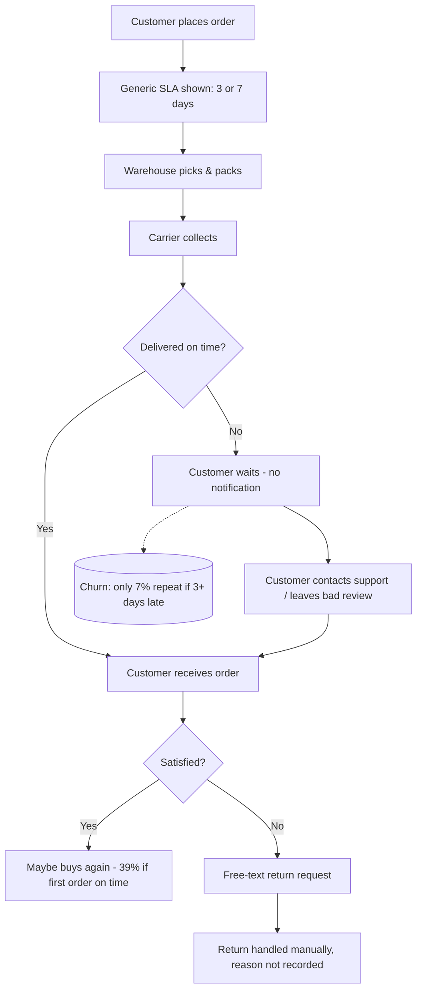
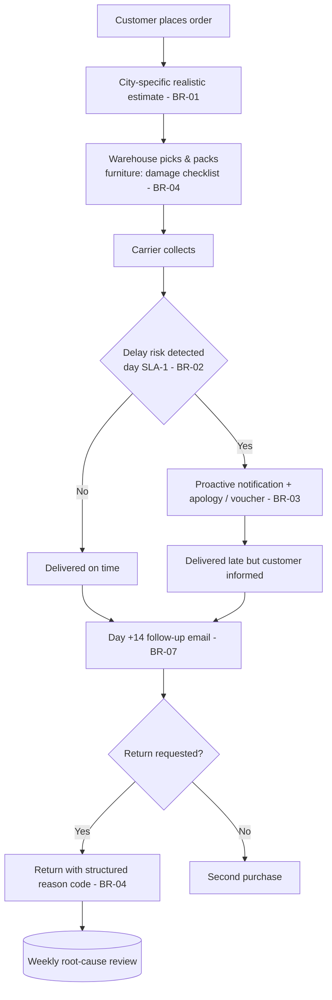

# 03 — Process: AS-IS vs. TO-BE (Order-to-Delivery)

## AS-IS
The same 3-day / 7-day promise is shown to every customer, nobody monitors lateness until complaints arrive, and returns have no structured reason.

### Pain points
| # | Pain point | Evidence |
|---|---|---|
| P1 | Same promise for every city, though Van/Diyarbakır average ~2.7 days late | Q6 |
| P2 | No proactive communication when an order is delayed | Q3 (rating 2.71 when 3+ days late) |
| P3 | Late first order kills the customer relationship | Q4 (7.1% repeat) |
| P4 | Furniture returns not analysed — no reason codes | Q5 (13.9% return rate) |
| P5 | No post-delivery follow-up to trigger the second purchase | Q4, Q8 (35% of revenue from one-time lapsed customers) |

## TO-BE
Realistic city-specific promise, monitoring with early-warning, proactive recovery, structured returns, and a follow-up trigger.

### Expected effects
| Change | Mechanism | Metric |
|---|---|---|
| Realistic estimate | Fewer broken promises, even if the number shown is larger | % orders 3+ days late ↓, rating ↑ |
| Proactive notice | Converts a silent failure into a managed one | repeat rate of late-first-order customers ↑ |
| Reason codes | Makes furniture returns diagnosable | return rate ↓ |
| Day +14 email | Targets the 39% on-time cohort at the moment of highest goodwill | repeat rate ↑ |
